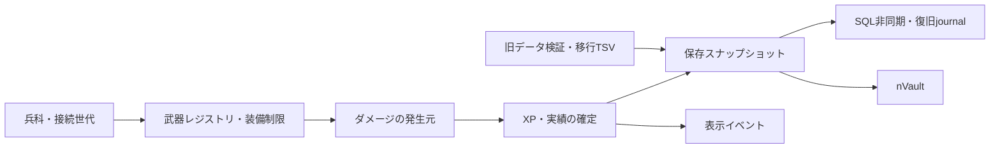

# BF4 V2の境界とAPI

## 責務

ランク本体はゲームイベントを受け取り、`include/bf4/progression_*` が設定、更新規則、保存、HUD、インポートを担当します。XPの確定にHUDの表示完了を要求しません。表示キューを破棄しても確定済み報酬は消えません。

兵科の現在値と次回スポーン用の予約値を分けます。予約変更時に現在装備を途中で剥がさず、スポーン時に新しい兵科・チームで再検査します。切断・再接続時には予約、装備、メニュー、表示待ち、遅延タスクの状態を引き継ぎません。

## 公開インターフェース

- 兵科API：`bf4classes.inc`。`BF4ClassesAPIVersion()`、`BF4GetSessionV2(id)`。接続世代は一時的な検査値で、保存キーではありません。
- 武器API：`bf4weapons.inc`。`BF4WeaponsAPIVersion()`、`BF4RegisterWeaponV2()`、`BF4WeaponKeyToHandleV2()`。V2の登録キーは `weapon:akm` のような固定値です。`knife`／`c4` などのエンジンITEM名は複数の装備が共有できます。
- ランクAPI：`bf4progression.inc`。準備状態、XP、レベル、ランク、保存キーの参照とXP・実績の付与。実績は `headshot`、`revive`、`ctf_capture` などの固定キーを使います。
- 旧nativeは同梱・外部プラグインの移行用wrapperとして残します。数値ハンドルは登録順で変わるため、外部ファイル・DBに保存しません。

## 保存の不変条件

1. 読み込み完了前・読み込み失敗時には保存しない。
2. SQL書き込みはプレイヤー識別子単位で直列化し、進行中に増えたrevisionを古い完了通知で消さない。
3. SQLの未保存値はローカルjournalで保全し、失敗時は再試行する。別ストアへ暗黙に切り替えない。
4. キーは接頭辞付き識別子として扱い、SQLではバイナリ列・16進リテラルで名前の大小文字やエスケープ設定による変形を避ける。
5. 移行は旧保存領域を変更せず、新保存領域の同一値は維持、異なる値は拒否する。

後半19カウンタは「獲得リボン累計」です。これを獲得メダル数へ変換すると旧閾値との互換性を失います。設定のXP報酬とBF4固有ボーナスは別の報酬理由として従来の値を保持します。

## 検証の限界

オフラインVMは本番の純粋ヘルパーと計数用エンジン境界を実行します。SQLエンジン、nVaultの稼働中復旧、GoldSrcのhook順序・メニュー・武器・複数クライアント動作は、検証サーバーでの受入が必要です。確認手順は `BUILD.md`、データ移行は `MIGRATION.md` を参照してください。
